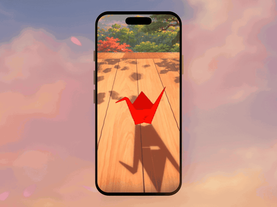

# Origami Crane: fold it, then let it fly

iPhone demo: fold a square of red washi into a paper crane with your finger, one swipe per crease. Drag along the dashed
arrow and the flap follows your finger in 3D; let go past halfway and it creases, too early and it springs back. After the
14th fold the crane comes alive: a sweep of light runs through the paper, it levitates, loops around an anime Japanese tea
room, flies out through the open panel and fades into the sunset. The paper is real-time 3D (292 facets lit by the low sun,
sorted exactly back to front, drawn as one Skia mesh); the fold sequence is baked in Blender. Design notes: [PLAN.md](PLAN.md).

<p align="center">
  <a href="docs/demo.mp4"></a>
  <br>
  <a href="docs/demo.mp4"><b>▶ Watch the promo with sound (MP4, 4:3, 43 s)</b></a>
</p>

Built with **Expo · React Native · [react-native-skia](https://shopify.github.io/react-native-skia/) (Graphite) ·
Reanimated 4 · Blender · NumPy**.

## What is in it

- **Real-time 3D paper in Skia.** The baked keyframes are interpolated on the UI thread (Reanimated worklets). Every facet is
  lit by the sun: two paper sides, light through the paper (it fades as the layers stack up), soft anime cel bands, gold
  flecks. The facet light rides in the texture coordinates, so one runtime shader draws the whole sheet as a single
  `Vertices` mesh, with a thin ink outline, a soft shadow on the floor and thin shadows along the sheet's cut edges.
- **Exact order, nothing shows through.** While folding, facets are sorted along a shared ray (parallel layers compare
  exactly). Once alive the wings swing on their hinges and one key per facet is not enough, so the crane is ordered with
  Newell's algorithm on plane groups (a group is drawn after another when it lies wholly on the camera's side of the
  other's plane), its layers are pressed together with a puffed-out body, and hairline cracks along hinges and between a
  leg's layers are closed by a morphological close of the silhouette under the paper.
- **An anime house in 3D layers.** Sky, hills, garden and the house frame are painted multiplane layers placed in 3D, so
  the camera has real parallax when it follows the crane out through the panel. The floor light is split into passes: the
  leaf dapples sway on the wood and on the paper, the furin (glass wind chime) swings with its shadow.
- **Leaves that tumble.** Painted maple leaves and sakura petals, mapped onto curled, twisted planes in Blender and
  rendered through one full tumble (16 frames, back-lit); the app picks the frame from each leaf's spin.
- **Three papers.** Every new sheet takes the next paper: vermilion washi, indigo chiyogami with gold flecks, sakura pink.
- **Sound.** In the app: paper creases, the awakening bell arpeggio, wing beats, a garden ambience (`tools/sfx.py`). The
  promo clips: a calm felt-piano score with strings and celesta (`blender/scripts/mix_calm.py`), −16 LUFS.

## App structure

```
app/src/scene/CraneScene.tsx   Canvas, layers, clock, camera rig, gestures, demo storyboard, scripted user, particles, sound
app/src/scene/camera.ts        packed perspective camera (worklet-friendly), projection, look-at
app/src/scene/clock.ts         shared clock (EXPO_PUBLIC_TIMESCALE for slowed recordings)
app/src/fold/mesh.ts           per-frame paper mesh: keyframe lerp, life transform, facet light, sort / Newell order, edges
app/src/fold/life.ts           the living crane: awaken, loops, out through the panel, across the sky, into the sun
app/src/fold/model.ts          decodes the baked fold (foldData.ts, generated by tools/pack_fold.mjs)
app/src/shaders/paper.ts       washi shader (cel bands, light through the paper, re-dye), post grade, sun mask
app/src/shaders/room.ts        floor light passes (dapples, furin shadow), multiplane layer shader
app/src/shaders/atmos.ts       god rays and dust indoors, the vanishing glow, the awakening light column
app/src/fx/particles.ts        particle pools (dust, glitter, tumbling leaves and petals) · fx/birds.ts · fx/sfx.ts
app/src/debug.ts               dev knobs (freeze a keyframe, start step, perf log, force demo / scripted user)
```

## Run

```bash
cd app
npm install
npx expo run:ios --port 8093
```

Swipe along the dashed arrow to fold; drag with two fingers to orbit; tap after the crane has flown for another sheet.

```bash
tools/fold.sh --no-render --force-write && node tools/pack_fold.mjs   # re-bake the fold → app/src/fold/foldData.ts
tools/build.sh                                                        # scene layers and floor light passes → app/assets/scene
```

`EXPO_PUBLIC_DEMO=1` plays the demo storyboard (the room in a wide shot, a slow push in to the sheet, a ghost finger
folding all 14 steps, the flight). `EXPO_PUBLIC_USERSIM=1` runs the interactive app driven by a scripted user through the
real pan and tap handlers (thinking pauses, curved swipes, a hesitant half swipe, iOS-style touch dots), for the real-use
recording.

## Blender

- `blender/scripts/fold_crane.py`: the crane in 14 steps, every layer a rigid stack 4 mm from the next, validated on every
  keyframe (no stretch, tears or crossings in steps 1–11 and 14). `tools/fold.sh` runs it headless.
- `blender/scripts/anime_scene.py`: the multiplane layers (Codex paintings) and the floor light passes, from the same camera
  as the app (`app/assets/scene/layout.json`).
- `blender/scripts/leaf_sprites.py`: the tumbling leaf sprites (`tools/leaf_key.py` → `tools/leaf_atlas.sh`).
- `blender/scripts/promo.py`: the 4:3 promo scene (titanium phone mockup, sunset sky, end card).

## Videos (like the showcase projects)

The recordings and renders live in `render/` (tens of GB), which is not in the repository; the scripts below rebuild them.
Two simulators: "Origami Crane 17 Pro Max" for development (Metro on port 8093) and "Origami Crane Rec 17 Pro Max" for
recordings (Release build, `notes/udid_rec.txt`).

```bash
tools/final.sh vN       # bundle the demo into the Release app, record at half speed (retakes frozen takes), event sheet,
                        # 4:3 promo → render/promo/origami-crane-demo-vN.mp4, contact sheet,
                        # 9:19 screen video → render/promo/origami-crane-screen-9x19-vN.mp4
tools/rec_user.sh vN    # real use: home screen, tap on the icon, the scripted user folds, the crane flies, another sheet
                        # → render/promo/origami-crane-user-9x19-vN.mp4 (beat sheet blender/scripts/beats/user_vN.json)
```

Pipeline details (sync marker, time conform, beat sheets, audio): [notes/promo.md](notes/promo.md). Version log:
[notes/versions.md](notes/versions.md). Dev helpers: `tools/burst.sh` (screenshot sheet of the dev sim, `AT=<event>`),
`tools/evcheck.sh` (a recording at every beat-sheet event), `tools/events.py` (event times from a dev run → beat sheet).

## License

[MIT](LICENSE) © Hoa Hoang ([@novahoangdev](https://x.com/novahoangdev)), from [@vgangstudio](https://x.com/vgangstudio)
with love.
